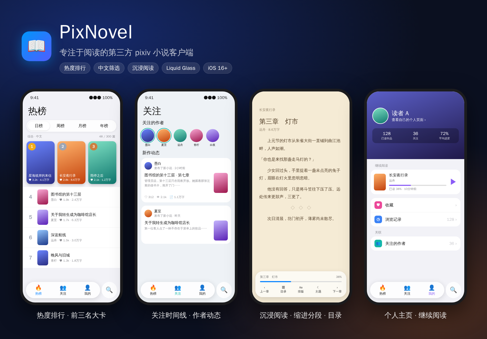
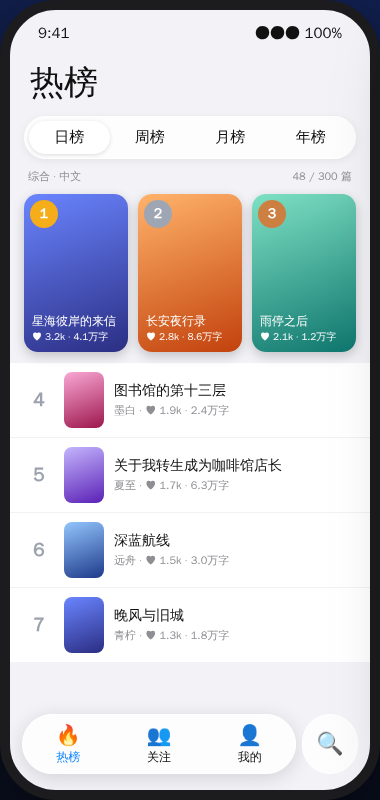
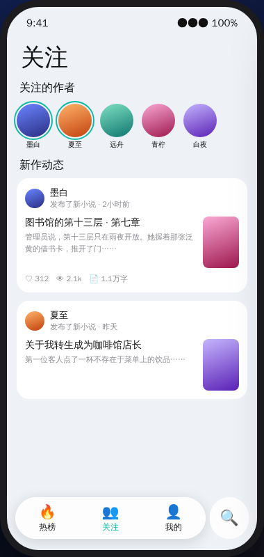
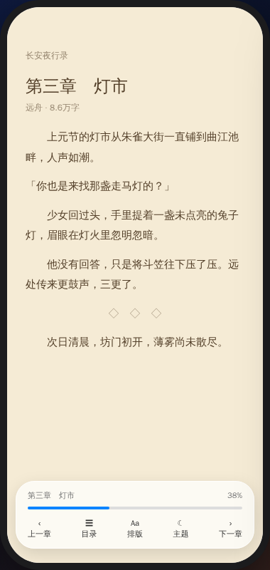
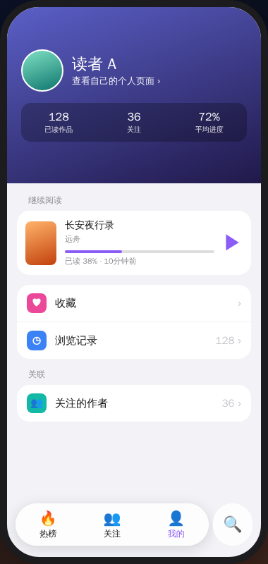

<div align="center">



# PixNovel

**专注于阅读的第三方 pixiv 小说客户端**

热度排行 · 中文筛选 · 沉浸阅读 · iOS Liquid Glass 设计

[**📲 下载安装**](https://cc1477.github.io/PixNovel/) · [版本发布](https://github.com/cc1477/PixNovel/releases) · [问题反馈](https://github.com/cc1477/PixNovel/issues)

</div>

---

## 为什么做 PixNovel

pixiv 官方 App 以插画为中心，小说只是附属功能：找不到好看的中文小说，热门排序要开会员，阅读体验也很一般。

PixNovel 只做一件事：**让在 pixiv 上找小说、读小说更舒服。**

## 界面预览

<table>
<tr>
<td align="center"><br><b>热榜</b></td>
<td align="center"><br><b>关注</b></td>
<td align="center"><br><b>阅读</b></td>
<td align="center"><br><b>我的</b></td>
</tr>
</table>

## 功能

### 🔥 热榜
- 日榜 / 周榜 / 月榜 / 年榜，自动加载完整榜单
- 二级分类：综合、男性向、女性向、新人、AI、长篇（5 万字以上）
- **月榜、年榜、长篇榜**来自 GitHub Actions 每日抓取积累的数据，按收藏数排序
- 可按收藏数、收藏率、日均收藏、综合热度等指标重新排序

### 🈶 中文与 R18 筛选
- 「仅中文」一键筛出中文作品（基于标题、简介、标签的文字特征识别）
- R18：全部 / 不含 / 仅 R18
- 筛选在热榜、关注、搜索之间共享

### 🔍 热度搜索
- 非会员也能按热度排序：聚合「热门预览」+「users入り 标签」+ 多页扫描，本地排序
- 会员直接使用官方热门排序，并支持二次排序
- 8 种排序指标：综合热度、收藏数、阅读数、收藏率（贝叶斯平滑）、日均收藏、评论数、最新、字数
- 时间范围、字数区间、最低收藏、隐藏 AI、仅原创、排除标签

### 👥 关注
- 关注作者头像条，7 天内有新作高亮
- 新作时间线：作者、发布时间、简介一目了然

### 📖 沉浸阅读
- 逐行分段 + 首行缩进（日式对白「」自动顶格）
- 多余空行压缩，`＊＊＊` 等场景分隔符居中
- 章节 / 分页 / 系列三栏目录，自动定位当前位置
- 上一章 / 下一章、上一话 / 下一话一键切换
- 6 种主题、4 种字体，字号、行距、段距、页边距可调
- 连续滚动或按原文分页，阅读进度自动保存
- 支持注音 `[[rb:]]`、插图、章节标记

### 💬 评论区
- 作品详情页与阅读器内都能打开
- 查看回复、发表评论、回复他人

### ✨ 其他
- iOS 26 Liquid Glass：悬浮玻璃底栏、独立搜索按钮、玻璃控件
- 收藏 / 取消收藏、关注作者、系列追更
- 浏览记录与继续阅读
- 图片反代（i.pixiv.re），网络请求限速与缓存，避免触发限流

## 安装

用 iPhone 的 Safari 打开 **[分发页](https://cc1477.github.io/PixNovel/)**：

| 方式 | 说明 |
| --- | --- |
| 全能签安装 | 唤起全能签下载并签名安装 |
| LCSign 安装 | 唤起 LCSign 导入 IPA |
| 添加软件源 | 在全能签 / LCSign 中添加源，自动获取更新 |
| 下载 IPA | 未签名 IPA，适用于 TrollStore、Sideloadly 等 |

系统要求：iOS 16 及以上（Liquid Glass 效果需 iOS 26+）。

## 登录

- **Safari 登录（推荐）**：使用系统 Safari 完成 pixiv 授权
- 内置网页登录
- Refresh Token 登录

登录凭据仅保存在本机钥匙串中，App 直接与 pixiv 官方服务器通信。中国大陆地区需自备可访问 pixiv 的网络环境。R18 内容需先在 pixiv 网页版「设置 → 浏览限制」中开启。

## 榜单数据服务

pixiv 小说没有官方月榜、年榜。本仓库通过 GitHub Actions 自建了一个零成本的数据服务：

1. `crawl.yml` 每天抓取日榜、周榜（含 R18），数据保存在 `rank-data` 分支
2. 汇总生成月榜、年榜、长篇榜，随分发页发布到 `https://cc1477.github.io/PixNovel/rank/`
3. App 直接读取这些 JSON

自行部署时，需要在仓库 **Settings → Secrets and variables → Actions** 中添加 `PIXIV_REFRESH_TOKEN`。首次可手动运行 Crawl Rankings，并填写 `days=60`、`weeks=52` 补抓历史数据。

## 构建

推送到 `main` 后，GitHub Actions 自动完成：编译未签名 IPA → 发布 Release → 部署分发页。只修改分发页或数据时不会重新编译 App。

本地构建需要 macOS + Xcode 26 + [XcodeGen](https://github.com/yonaskolb/XcodeGen)：

```bash
brew install xcodegen
xcodegen generate
open PixNovel.xcodeproj
```

## 声明

PixNovel 是非官方的第三方客户端，与 pixiv Inc. 无关。所有作品版权归原作者所有，本项目仅供学习交流。
